<div align="center">


<a href="https://github.com/Aks98068?tab=repositories"></a>
<a href="https://github.com/Aks98068?tab=repositories"></a>
<a href="https://github.com/Aks98068?tab=repositories"></a>





</div>

---


# ⚙️ Tools, Technologies & Development

## 🛠️ Tools

<p align="center">
  
  
  
  
</p>

## 💻 Technologies & Development

<p align="center">
  
</p>

## 💻 Programming Languages

<p align="center">
  
</p>

---

---

---

# 🦓 Public Project — Zebra

### Zebra — Go Security & Reconnaissance Toolkit

**Zebra** is a Go-based command-line toolkit focused on cybersecurity, networking, reconnaissance, system utilities, and security-related workflows.

The project is developed by **Abhishekh Kumar Sah (Aks98068)** and is part of my practical exploration of **Go programming, cybersecurity, networking, reconnaissance, and system-level development**.

### 🔧 Zebra Focus Areas

- 🐹 Go CLI Development
- 🌐 Network Reconnaissance
- 🔍 Security Reconnaissance
- 🛡️ Cybersecurity Utilities
- 🔐 TLS / SSL Inspection
- 🌐 DNS Analysis
- 🖥️ System Utilities
- ⚙️ Command-Line Tooling

<p align="center">
  <a href="https://github.com/Aks98068/zebra">
    
  </a>
</p>

---


# 📊 GitHub Activity

<p align="center">
  
  
</p>

<p align="center">
  
</p>

---

# 📈 Contribution Activity

<p align="center">
  
</p>

---

# 🎯 My Goals

```text
🛡️ Build practical cybersecurity projects
🔍 Develop Digital Forensics tools
🌐 Build networking and network analysis projects
🔗 Explore blockchain technologies and security
🔬 Conduct meaningful research
🤖 Develop AI-driven security systems
🌍 Contribute to open-source projects
📚 Continuously improve my technical knowledge
🐹 Build production-quality Go security tools
```

---

# 🤝 Connect With Me

<p align="center">
  <a href="https://github.com/Aks98068">
    
  </a>
  <a href="https://www.linkedin.com/in/abhishekh-kumar-sah-b8151a353/">
    
  </a>
  <a href="mailto:abishek98071a@gmail.com">
    
  </a>
</p>

---

# 🛡️ Professional Philosophy

> **"Technology evolves continuously, and so must our ability to understand, secure, investigate, and innovate."**

<p align="center">
  🛡️ Cybersecurity • 🌐 Networking • 🔗 Blockchain • 🔍 Digital Forensics • 🐹 Go
  <br><br>
  ⭐ Thanks for visiting **Abhishekh Kumar Sah (@Aks98068)**'s GitHub profile!
</p>
